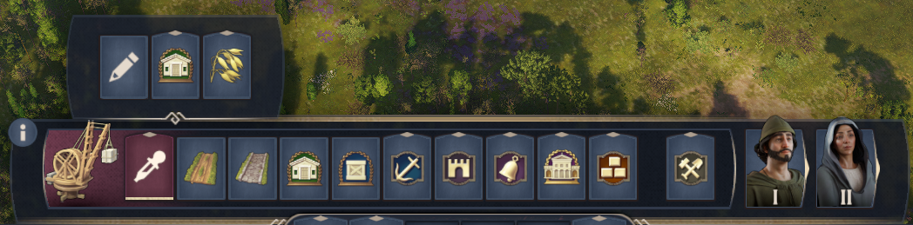
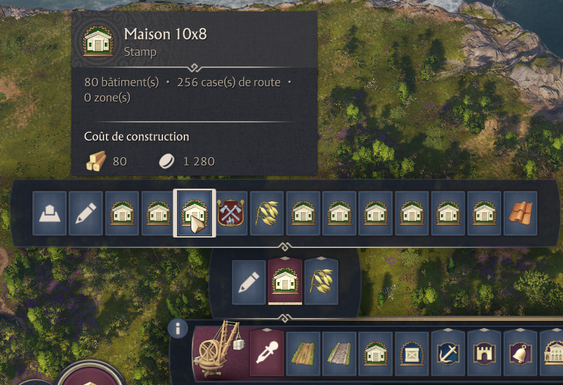

# Anno117 Stamps

[English](#english) · [Français](#français)





## English

Create, organize and place stamps directly from the construction menu in
**Anno 117 — Pax Romana**.

The interface follows the game language: English, French, German, Italian, Spanish,
Brazilian Portuguese, Polish, Russian, Japanese, Korean, Simplified Chinese and Traditional Chinese.
Stamp and folder icons can be changed from their management menus. The icon
picker displays the game's icons in a native window with scrolling and search.

### Download

Download and extract the ZIP from [Releases](https://github.com/flamme-demon/Anno117-Stamps/releases).
It contains the DLL, the complete mod and optional Linux/Windows installers.

Close the game before installing.

### Linux / Proton

1. Open the game's Proton prefix (`drive_c`).
2. Before replacing the original `dbghelp.dll`, keep it in the same folder as
   **`dbghelp_orig.dll`**. Keep this backup when updating.
3. Copy the downloaded **`dbghelp.dll`** into:

   ```text
   drive_c/Program Files (x86)/Ubisoft/Ubisoft Game Launcher/games/Anno 117 - Pax Romana/Bin/Win64/
   ```

4. Copy the **`anno117-stamps-native-ui`** folder from the ZIP's `mods` folder into:

   ```text
   drive_c/users/steamuser/Documents/Anno 117 - Pax Romana/mods/
   ```

### Windows

1. Before replacing the original `dbghelp.dll`, keep it in the same folder as
   **`dbghelp_orig.dll`**. Keep this backup when updating.
2. Copy the downloaded **`dbghelp.dll`** into:

   ```text
   C:\Program Files (x86)\Ubisoft\Ubisoft Game Launcher\games\Anno 117 - Pax Romana\Bin\Win64\
   ```

3. Copy the **`anno117-stamps-native-ui`** folder from the ZIP's `mods` folder into:

   ```text
   C:\Users\<your username>\Documents\Anno 117 - Pax Romana\mods\
   ```

If the game is installed elsewhere, use its own `Bin/Win64` folder.
Enable the mod in the game's mod manager, then open **Stamps** in the construction menu.
Your stamps are kept in the game's Documents folder, under **`stamps`**.
That folder is created automatically if needed.

### Change icons

1. Open a stamp's or folder's management menu and choose **Change icon**.
2. Browse the images with the mouse wheel, or use Page Up/Down, Home and End.
   The window stays open while you browse.
3. Click an image to apply it. **Search** accepts an icon filename or an icon ID;
   an empty search shows all icons. **Default icon** restores the default choice,
   and **Back** returns to the management menu.

The picker contains 2,100 distinct game icon textures. Changing a stamp icon
updates its native `IconGUID` without changing its buildings, roads or areas.
Folder icons are saved separately and restored on the next launch.

### License

[MIT](LICENSE). MinHook and miniz retain their own licenses. The included native
popup widget originates from the game.

## Français

Créer, organiser et poser des stamps directement dans le menu de construction
d’**Anno 117 — Pax Romana**.

L’interface suit la langue du jeu : français, anglais, allemand, italien, espagnol,
portugais brésilien, polonais, russe, japonais, coréen, chinois simplifié et chinois traditionnel.
Les icônes des stamps et des dossiers se changent depuis leur menu de gestion.
Le sélecteur affiche les icônes du jeu dans une fenêtre native avec défilement
et recherche.

### Téléchargement

Télécharger et extraire le ZIP dans [Releases](https://github.com/flamme-demon/Anno117-Stamps/releases).
Il contient la DLL, le mod complet et des installateurs Linux/Windows facultatifs.

Fermer le jeu avant l’installation.

### Linux / Proton

1. Ouvrir le préfixe Proton du jeu (`drive_c`).
2. Avant de remplacer le `dbghelp.dll` d’origine, le conserver dans le même dossier
   sous le nom **`dbghelp_orig.dll`**. Garder cette sauvegarde lors des mises à jour.
3. Placer le **`dbghelp.dll`** téléchargé dans :

   ```text
   drive_c/Program Files (x86)/Ubisoft/Ubisoft Game Launcher/games/Anno 117 - Pax Romana/Bin/Win64/
   ```

4. Placer le dossier **`anno117-stamps-native-ui`**, situé dans `mods` dans le ZIP, dans :

   ```text
   drive_c/users/steamuser/Documents/Anno 117 - Pax Romana/mods/
   ```

### Windows

1. Avant de remplacer le `dbghelp.dll` d’origine, le conserver dans le même dossier
   sous le nom **`dbghelp_orig.dll`**. Garder cette sauvegarde lors des mises à jour.
2. Placer le **`dbghelp.dll`** téléchargé dans :

   ```text
   C:\Program Files (x86)\Ubisoft\Ubisoft Game Launcher\games\Anno 117 - Pax Romana\Bin\Win64\
   ```

3. Placer le dossier **`anno117-stamps-native-ui`**, situé dans `mods` dans le ZIP, dans :

   ```text
   C:\Users\<votre nom>\Documents\Anno 117 - Pax Romana\mods\
   ```

Si le jeu est installé ailleurs, utiliser son propre dossier `Bin/Win64`.
Activer le mod dans le gestionnaire de mods du jeu, puis ouvrir **Stamps** dans le menu de construction.
Les stamps sont conservés dans les Documents du jeu, dans le dossier **`stamps`**.
Ce dossier est créé automatiquement si nécessaire.

### Changer les icônes

1. Ouvrir le menu de gestion d’un stamp ou d’un dossier et choisir **Changer l’icône**.
2. Parcourir les images avec la molette, ou les touches Page précédente/suivante,
   Début et Fin. La fenêtre reste ouverte pendant le défilement.
3. Cliquer sur une image pour l’appliquer. **Rechercher une icône** accepte un nom
   de fichier d’icône ou un ID ; une recherche vide affiche tout. **Icône par défaut**
   rétablit le choix par défaut et **Retour** revient au menu de gestion.

Le sélecteur contient 2 100 textures d’icônes distinctes du jeu. Changer l’icône
d’un stamp modifie son `IconGUID` natif en conservant ses bâtiments, routes et zones.
Les icônes des dossiers sont enregistrées séparément et retrouvées au prochain lancement.

### Licence

[MIT](LICENSE). MinHook et miniz conservent leurs propres licences. Le widget
natif de dialogue fourni provient du jeu.
